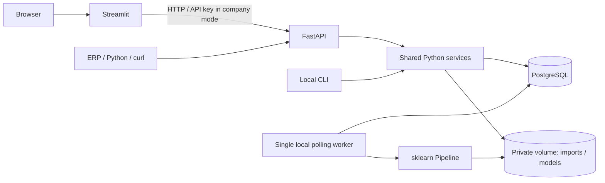

# Architecture

`quality.py` owns parsing and business validation, `service.py` owns transactional
imports/analytics/prediction, `ml.py` owns chronological evaluation and worker.
The UI calls the API: no second implementation of domain rules. CLI imports use
the same service; CLI is a trusted infrastructure operator interface.

Alembic owns schema creation. PostgreSQL stores orders, import receipts, run states,
full evaluation metadata and a single active model pointer. Sources, rejected CSVs,
training snapshots and joblib artifacts live in the private volume. No user-supplied
serialized model is accepted. Keep DB and file backups consistent.

Orders have current operational columns and a separate immutable `initial_snapshot`.
A PostgreSQL trigger prevents replacement, including on legacy null snapshots.
Training joins the original inputs to the current observed outcome; declared
feature corrections exclude the snapshot rather than rewrite historical truth.
Read [the data contract](data-contract.md) before preparing an ERP export.

POST /training-runs queues a persistent job and returns 202 immediately. The worker
uses a PostgreSQL session advisory lock, marks queued → running, snapshots orders
under the writer lock, then trains outside the transaction. One pending training
per instance. A second worker cannot train concurrently. On restart, orphaned
running jobs become failed with `worker_interrupted`; the operator must enqueue a
new run. Work is not silently restarted and no model is automatically activated.

Imports are bounded, synchronous operations performed off the async event loop.
Use the CLI for manual operator imports if HTTP timeouts are unsuitable. For a
larger pilot, measure first; the current writer lock and in-memory training are
intentional ceilings, not a distributed job platform.

Compose starts db → migration → API/worker → UI. Only API/UI ports are published,
on loopback. Outbound runtime network calls are not part of business processing;
package/image downloads are required during installation. Streamlit usage stats
are disabled. API logs contain only event, random request ID, HTTP method, status
and elapsed time, without URL parameters, headers, SQL parameters or row content.
Unexpected-error records add exception type and technical code locations, linked
to the request or training run, without formatting exception messages or locals.
Prediction loading uses a bounded process-local cache keyed by active model,
artifact fingerprint, dependency manifest and file metadata.

Official references used in implementation:
[sklearn composite estimators](https://scikit-learn.org/stable/modules/compose.html),
[FastAPI APIKeyHeader](https://fastapi.tiangolo.com/reference/security/#fastapi.security.APIKeyHeader),
[Streamlit API](https://docs.streamlit.io/develop/api-reference).
